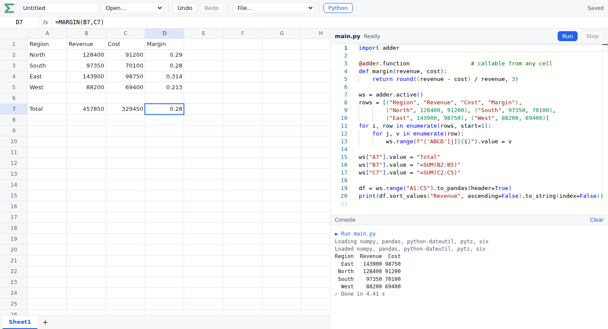

<p align="center"></p>

<p align="center"><b>A spreadsheet that runs Python, entirely in your browser.</b></p>

<p align="center">
Excel-style formulas · a canvas grid that stays smooth at 100k rows · Python scripts and custom functions via Pyodide · xlsx &amp; CSV · no server, no account
</p>

<p align="center"></p>

---

## Why

Spreadsheets are great at showing data and bad at expressing logic. Google Sheets gives you Apps Script and Excel gives you VBA. Adder gives you **Python**, with pandas and numpy, running locally next to your sheet. You don't need a backend, an install or a sign-in. Your workbooks stay in your browser.

## Write Python, call it from a cell

```python
import adder

@adder.function                        # now =MARGIN(B2, C2) works in any cell
def margin(revenue, cost):
    return round((revenue - cost) / revenue, 3)

@adder.on_edit("Sheet1!B:B")           # react to edits in column B
def stamp(event):
    event.range.offset(cols=1).value = f"changed to {event.value}"

ws = adder.active()
df = ws.range("A1:C100").to_pandas(header=True)
ws.range("F1").from_pandas(df.groupby("Region").sum().reset_index())
```

- **Custom functions:** decorate a Python function and call it from any formula. It recalculates when its inputs change, just like `SUM`.
- **Edit hooks:** run Python whenever the user edits a range.
- **Ranges ↔ pandas:** read a range into a DataFrame and write one back in a single line.
- **Fast round-trips:** reads are synchronous and writes are batched. Writing 10k cells one at a time takes about 35 ms.
- **Interruptible:** Stop sends a `KeyboardInterrupt`. If the script still won't stop, the worker is restarted.

## A real spreadsheet underneath

- **Formulas:** Excel-compatible functions, recalculation and multiple sheets, powered by [IronCalc](https://github.com/ironcalc/IronCalc) compiled to WebAssembly.
- **Speed at scale:** the grid is drawn on a canvas with virtual scrolling. It holds 60 fps at 100,000 × 26 cells, with a median paint time of about 4 ms.
- **Familiar editing:**
  - Formula bar, and click-to-reference while typing a formula.
  - Copy/paste that keeps formulas and works with other apps.
  - Paste-to-fill and Ctrl+Enter fill.
  - Undo/redo.
  - Selecting, inserting and deleting whole rows and columns.
  - Excel keyboard navigation.
- **Files:** .xlsx import and export, and CSV with delimiter sniffing.
- **Local-first:** workbooks autosave to IndexedDB.

## Try it

```sh
npm install
npm run dev          # http://localhost:5173
```

Open the **Python** panel, write a script and press **Ctrl+Enter**. Python loads on the first run. To see how the grid copes with a big sheet, open [`/?seed=100000`](http://localhost:5173/?seed=100000).

```sh
npm test             # unit tests (vitest)
npm run e2e          # browser tests (playwright; needs: sudo npx playwright install-deps chromium)
```

## Deploy

Adder is a static site. It needs two response headers: `Cross-Origin-Opener-Policy: same-origin` and `Cross-Origin-Embedder-Policy: credentialless`. Python only runs when the page is cross-origin isolated.

- The `Dockerfile` builds the app and serves it with nginx. `deploy/nginx.conf` sets those headers and the cache policy, and redirects `www.` to the apex domain.
- `npm run deploy` builds on Cloud Build and deploys to Cloud Run. It requires a clean git tree.
- Set `PROJECT` and `REGION` to override the defaults, `adder-app-511522` and `europe-west1`.

## Python API

```python
ws = adder.sheet("Sheet1")             # or adder.active(), adder.sheet(0), adder.add_sheet("Out")
ws["A1"].value = 42                    # strings starting with "=" are formulas
vals = ws.range("A1:C100").values      # list[list]; errors come back as adder.CellError
df = ws.range("A1:C100").to_pandas(header=True)
ws.range("E1").from_pandas(df)
adder.range("'My Sheet'!B:B").values   # whole columns are clipped to the used range

@adder.function
def total(rows):                       # range arguments arrive as list[list]
    return sum(v for r in rows for v in r if isinstance(v, (int, float)))

@adder.on_edit("Sheet1!B:B")           # event.sheet, event.range, event.values, event.value
def on_b(event): ...
```

Running a script registers its functions and hooks again. While a custom function's result is pending, its cell shows `#CALC!`. If the function raises, the cell shows `#VALUE!` and the traceback goes to the console.

## How it works

```
React chrome + canvas grid
        │
Engine adapter (TypeScript) ←→ IronCalc (WASM)     single source of truth for cells
        │  SharedArrayBuffer + Atomics
Pyodide in a Web Worker ── the `adder` module
```

- **Synchronous reads from a worker:** the Python worker blocks on `Atomics.wait` while the main thread answers over a SharedArrayBuffer (`src/python/channel.ts`). This is why the dev server sends COOP/COEP headers.
- **Custom functions on an engine with no plugin hook:** each call site gets a row on a hidden `__adder` sheet.
  - Argument "mirror" cells there let IronCalc track dependencies.
  - Adder diffs the mirrors after each change and calls Python only when an argument changed.
  - Results are written back outside the undo history.
  - The original formula text is rebuilt for the formula bar and for export, so these cells survive inserts, undo and xlsx round-trips.
- **Batched writes:** Python buffers its writes, groups them into rectangles and sends each rectangle as one engine call. Each rectangle is a single undo step.
- **Used-range caching:** IronCalc's row scan is O(sheet), so the adapter keeps its own used range and grows it on each write.

Built with TypeScript, Vite, React (for the chrome only), IronCalc 0.8.4, Pyodide (Python 3.14), Monaco and SheetJS CE.

## Limitations

- **xlsx styles:** the published IronCalc WASM package doesn't include its xlsx reader/writer yet, so files go through SheetJS CE.
  - Values, formulas, number formats, column widths and sheet names round-trip.
  - Fonts, fills, borders and alignment are lost on export.
  - Switching back is one `XlsxCodec` implementation away.
- **Precision of formula results in Python:** about 9 significant digits, because IronCalc has no raw-value API. Literal inputs keep full precision.
- **Custom function results:** they must be single values. Copying a custom-function cell copies a reference to the same result rather than making a new call.
- **`on_edit` events:** they carry new values only, not old ones.
- **Not planned for now:** real-time collaboration, charts and pivot tables.
